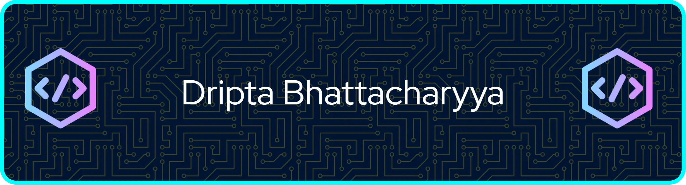
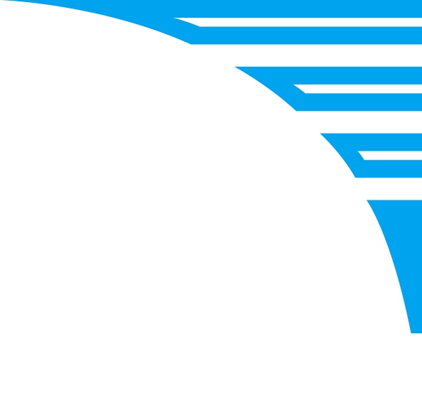
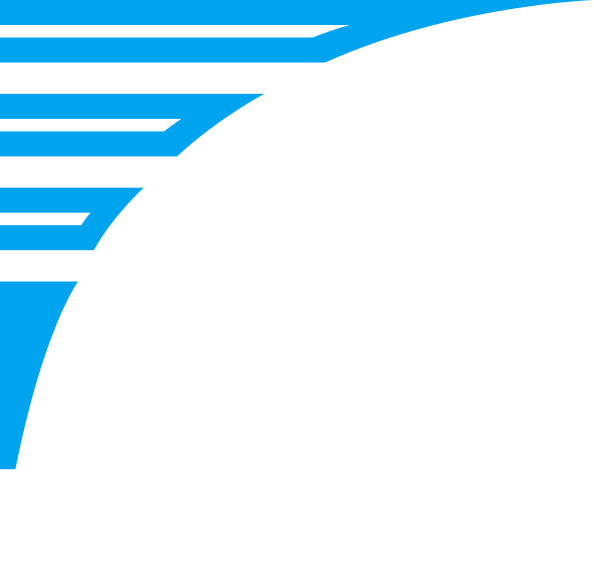

<link rel="stylesheet" href="./styles.css" />

  

---

# 💫 About Me:

<!--
- 🔭 I’m currently working on ...
- 👯 I’m looking to collaborate on ...
- 🤔 I’m looking for help with ...
-->

- I am a BTech CSE student at KIIT (2026-30 batch) 
- 🌱 I’m currently learning quant, ML, DL

## 🌐 Socials:

<!-- ## 🏆 GitHub Trophies

  

 -->

## 📊 GitHub Stats:

  
  
  
   
  
   
  

### 🔝 Top Contributed Repo

  

---

# 💻 Tech Stack:

## Programming Languages

## AI/ML Libraries

## Databases

### ✍️ Random Dev Quote

---

  

